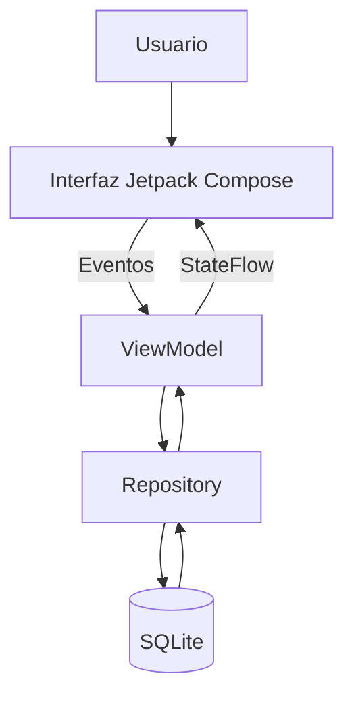

EcoRecicla Mobile
Recicla · Gana · Transforma

Aplicación móvil Android que incentiva el reciclaje mediante un sistema de puntos y recompensas, desarrollada con Kotlin, Jetpack Compose y SQLite.
   
1. ¿Qué es EcoRecicla?
EcoRecicla nace como una propuesta de emprendimiento tecnológico y ambiental que busca incentivar la separación y el aprovechamiento de residuos reciclables. Nuestra idea consiste en convertir una acción cotidiana, como depositar correctamente una botella de plástico o separar papel y cartón, en una experiencia que genere beneficios para las personas y su entorno.

Buscamos ofrecer, a futuro, un servicio de reciclaje incentivado a instituciones educativas, empresas, conjuntos residenciales y otras organizaciones interesadas en fortalecer su cultura ambiental. Las entidades que decidan contratar el servicio podrían implementar un sistema de recolección, seguimiento e incentivos adaptado a sus necesidades.

La aplicación móvil es una pieza de ese ecosistema: permite registrar actividades de reciclaje, consultar el impacto individual, acumular puntos y canjearlos por recompensas.
2. Contexto académico: Fundación Universitaria San Mateo
Para este proyecto académico seleccionamos la Fundación Universitaria San Mateo como escenario de referencia. Queremos fomentar entre los estudiantes hábitos responsables de disposición de residuos, reducir la basura arrojada en espacios comunes y contribuir a mantener una universidad más limpia y agradable.

La elección de la institución no implica una contratación, financiación, alianza comercial ni implementación oficial. Se trata de una propuesta académica que permite demostrar la viabilidad funcional del sistema en un contexto universitario concreto.
Información	Detalle
Institución	Fundación Universitaria San Mateo
Programa	Ingeniería de Sistemas
Asignatura	Desarrollo de App Móviles
Semestre	Sexto
Docente	Daniel Fernando Medina Toscano
Proyecto	EcoRecicla Mobile
Entrega	Avance académico — noviembre de 2026

3. Problemática identificada
La disposición inadecuada de residuos afecta la limpieza de los espacios compartidos y dificulta el aprovechamiento de materiales reciclables. Aunque existen campañas de sensibilización, no siempre ofrecen mecanismos que permitan a las personas reconocer su aporte o mantener la motivación a largo plazo.

EcoRecicla plantea complementar la educación ambiental con incentivos, seguimiento de actividades y metas personales. No pretende sustituir las campañas de sensibilización ni los procesos de gestión de residuos, sino facilitar la participación activa de los usuarios.
4. Objetivos
Objetivo general
Desarrollar una solución móvil que promueva hábitos sostenibles mediante el registro de reciclaje, la acumulación de puntos y el acceso a recompensas, con una experiencia de usuario sencilla y una arquitectura mantenible.
Objetivos específicos
- Incentivar la separación adecuada de materiales reciclables.
- Promover el cuidado y la limpieza de los espacios universitarios.
- Permitir que cada usuario consulte su participación y progreso ambiental.
- Implementar un sistema funcional de puntos, recompensas y canjes.
- Garantizar la persistencia local de los datos mediante SQLite.
- Aplicar los conocimientos de Kotlin, Jetpack Compose, navegación, gestión de estado y patrones de diseño.
- Establecer una base tecnológica que pueda evolucionar hacia un servicio para diferentes organizaciones.
5. Propuesta de valor y modelo de servicio proyectado
Beneficiario	Valor propuesto
Estudiantes y usuarios	Reconocimiento de sus acciones, puntos, recompensas y seguimiento personal.
Instituciones educativas	Apoyo a campañas ambientales y promoción del cuidado de espacios comunes.
Empresas y otras entidades	Posibilidad de implementar programas de reciclaje incentivado adaptados a su comunidad.
Entorno ambiental	Potencial reducción de residuos mal dispuestos y mayor aprovechamiento de materiales.

A futuro se plantea un modelo de prestación de servicios a organizaciones, que podría incluir instalación o integración de puntos de recolección, licenciamiento de software, soporte, administración de incentivos y reportes ambientales. Las condiciones comerciales, financiación de recompensas y mecanismos de validación física deberán definirse antes de una implementación real.

Estos beneficios son objetivos esperados; todavía no contamos con mediciones de impacto institucional ni contratos comerciales.
6. Funcionamiento de la aplicación
1. El usuario crea una cuenta e inicia sesión.
2. Accede a su panel personal, donde consulta puntos, kilogramos y reciclajes realizados.
3. Selecciona el material reciclable e ingresa su peso.
4. El sistema registra la operación y asigna puntos según las reglas configuradas.
5. El usuario consulta el catálogo y canjea una recompensa si dispone de saldo y existencias suficientes.
6. El sistema actualiza el saldo y permite consultar los movimientos en el historial.
7. El usuario puede consultar su perfil y cerrar sesión.
En el avance actual el registro del material es manual. No existe todavía una máquina conectada que certifique el peso o la entrega física del residuo.
7. Funcionalidades implementadas
Módulo	Funcionalidad
Autenticación	Registro e inicio de sesión mediante almacenamiento local.
Dashboard	Saludo personalizado, saldo, peso acumulado y cantidad de reciclajes.
Reciclaje	Selección de material, ingreso de peso y generación de puntos.
Recompensas	Catálogo, costo en puntos y disponibilidad.
Canjes	Descuento de puntos y actualización de existencias.
Historial	Consulta de reciclajes y canjes, con filtros por tipo de movimiento.
Perfil	Consulta de información personal y cierre de sesión.
Persistencia	Base de datos SQLite independiente de la aplicación web.

8. Tecnologías utilizadas
- Kotlin: lenguaje principal y lógica de negocio.
- Jetpack Compose: construcción declarativa de interfaces mediante funciones @Composable.
- Material 3: componentes, colores, tipografía y experiencia visual.
- SQLite: almacenamiento local de la información.
- Navigation Compose: navegación entre destinos de la aplicación.
- ViewModel y StateFlow: gestión reactiva del estado de la interfaz.
- Gradle: configuración y administración de dependencias.
- Git y GitHub: control de versiones y publicación del código fuente.
- Android Studio: entorno de desarrollo y pruebas en emulador Pixel 6, API 35.
9. Arquitectura del software
Se utiliza MVVM (Model–View–ViewModel), complementado con repositorios para separar la presentación, el estado y el acceso a datos.

com.example.ecorecicla.mobile/
├── data/
│   ├── local/          # Base de datos SQLite
│   ├── remote/         # Preparación para integración futura
│   └── repository/     # Operaciones de acceso a datos
├── navigation/         # Rutas y flujo de navegación
├── ui/
│   ├── components/     # Espacio para componentes compartidos
│   ├── screens/        # Pantallas de la aplicación
│   └── theme/          # Identidad visual
├── viewmodel/          # Estado y lógica de presentación
└── MainActivity.kt     # Punto de entrada
Patrones de diseño
Patrón	Aplicación
Repository	Centraliza las operaciones de autenticación, dashboard, reciclaje y recompensas.
Observer	StateFlow permite que Compose observe cambios de estado y recomponga la interfaz.
Singleton	Implementado en RetrofitClient como preparación para una integración remota.
Factory Method	ApiServiceFactory encapsula la creación del servicio remoto.
Builder	Utilizado en la configuración de Retrofit y OkHttp.

MVVM corresponde a la arquitectura de presentación. Los componentes remotos son preparatorios: no intervienen en el flujo funcional actual, que utiliza SQLite.
10. Persistencia y reglas de negocio
La base de datos local permite gestionar cuentas, registros de reciclaje, puntos, recompensas y canjes sin depender de un servidor externo. La aplicación móvil es independiente del aplicativo web EcoRecicla.

El sistema relaciona las operaciones con el usuario autenticado y aplica reglas para calcular puntos y restringir canjes cuando el saldo es insuficiente. La versión académica no debe considerarse una plataforma comercial lista para producción: requiere revisión adicional de seguridad, integridad y pruebas de casos límite.
11. Evidencia de funcionamiento
Durante las pruebas en el emulador se observó el siguiente recorrido:
Operación	Resultado observado
Saldo inicial	0 puntos
Registro de plástico	2.5 kg
Puntos obtenidos	+250
Canje de cuaderno ecológico	−200
Saldo final	50 puntos
Reciclajes realizados	1

El historial mostró tanto el registro de reciclaje como el canje. El catálogo presentó las recompensas no disponibles para el saldo restante mediante el mensaje «Puntos insuficientes». También se comprobó el acceso al perfil y el retorno al login al cerrar sesión.

Se realizó además una prueba interactiva del patrón Observer con datos de demostración: el dashboard cambió de 1250 a 1500 puntos, de 18.5 a 21.0 kg y de 12 a 13 reciclajes. Esta prueba aislada demuestra la actualización reactiva de la interfaz y es distinta de las operaciones reales con SQLite descritas anteriormente.
12. Instalación y ejecución
Requisitos: Android Studio, SDK de Android compatible con la configuración Gradle del proyecto y un emulador o dispositivo Android.
git clone https://github.com/Pancarto/EcoReciclaMobile.git
1. Abrir la carpeta EcoReciclaMobile en Android Studio.
2. Esperar la sincronización de Gradle y la instalación de dependencias.
3. Seleccionar un dispositivo o emulador (se utilizó Pixel 6 API 35).
4. Ejecutar la configuración app mediante Run.
5. Crear una cuenta local y recorrer las funcionalidades.
No es necesario configurar una API, un servidor web ni una base de datos externa para ejecutar el flujo local.
13. Correspondencia con el parcial académico
Entregable	Evidencia o implementación
1. Problema y alcance	Contexto ambiental, objetivos y alcance funcional de este README.
2. Estructura del proyecto	Paquetes, recursos, manifiesto y Gradle.
3. Interfaces declarativas	Pantallas Compose y componentes Material 3.
4. Experiencia de usuario	Identidad visual, validaciones, estados y diálogo de perfil.
5. Gestión de estado	ViewModels, StateFlow, eventos y validaciones.
6. Navegación	Rutas y flujo de autenticación, reciclaje, recompensas e historial.
7. Ciclo de vida y persistencia	ViewModel y SQLite; pruebas adicionales de rotación y cierre de proceso pendientes.
8. Funcionalidades core	Recorrido funcional de autenticación, reciclaje y canje.
9. Control de versiones	Repositorio GitHub, historial de commits y documentación técnica.
10. Sustentación	Arquitectura, decisiones técnicas, demostración y plan de evolución.

14. Proyección futura
- Validar la persistencia tras cierre del proceso, rotación y escenarios límite.
- Fortalecer la seguridad y ampliar las pruebas automatizadas.
- Incorporar mecanismos de verificación de entrega física de materiales.
- Evaluar la integración con estaciones de reciclaje inteligentes y medición de peso.
- Desarrollar un panel administrativo para entidades que adopten el servicio.
- Incorporar reportes ambientales, campañas y metas colectivas.
- Evaluar sincronización en nube y soporte para múltiples organizaciones.
- Definir alianzas y mecanismos sostenibles de financiación de recompensas.
- Realizar un piloto autorizado y medir resultados antes de una implementación comercial.
15. Conclusión
EcoRecicla Mobile demuestra cómo la ingeniería de sistemas puede aportar a una problemática ambiental mediante una aplicación funcional que vincula tecnología, educación e incentivos. Nuestro propósito es que reciclar deje de percibirse únicamente como una obligación y se convierta en un hábito reconocido y motivador.

Este avance académico constituye una base para continuar desarrollando una solución adaptable a comunidades e instituciones que quieran impulsar una cultura ambiental responsable.

Repositorio: Pancarto/EcoReciclaMobile
EcoRecicla — Cada acción cuenta para un futuro sostenible.
